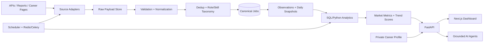

# System Architecture

## Context
External permitted job APIs, employer career pages, labor statistics and hiring reports feed two product domains: (1) public market intelligence and (2) private career planning.

## Flow

## Services
| Service | Responsibility |
|---|---|
| Web | Dashboard, filters, charts, career workspace |
| API | Auth, validation, market/career endpoints |
| Ingestion worker | Fetch source records, persist payloads and run metadata |
| Normalizer | Canonical jobs, companies, locations, roles and skills |
| Analytics worker | Daily snapshots, monthly metrics, trend scoring |
| AI worker | Evidence-grounded explanations and career plans |
| PostgreSQL | Canonical entities, time series, taxonomy and user data |
| Redis | Queue, retries, coordination and cache |
| Object storage | Raw payloads and report artifacts |

## Data boundaries
- Raw source payloads are retained with provider ID and payload hash.
- Canonical job != source observation != aggregate snapshot.
- Snapshots are immutable and methodology-versioned.
- Public market metrics never contain personal career data.
- RLS protects user-owned records; service credentials stay server-side.

## Ingestion lifecycle
1. Scheduler creates source run.
2. Adapter fetches bounded pages and records metadata.
3. Raw payload archived and hashed.
4. Schema checks; malformed rows quarantined.
5. Normalize title, company, location, dates and employment attributes.
6. Resolve role/company/location; extract skills.
7. Upsert canonical job and append observation.
8. Update active status using source-specific expiry policy.
9. Build daily snapshots and aggregates.
10. Publish only after freshness and quality gates.

## Reliability
Retries use exponential backoff + jitter; bounded attempts lead to dead-letter. Idempotency uses source/provider ID (fallback fingerprint). Monitor source freshness, schema drift, accepted/rejected ratios, duplicates and snapshot completeness.

## AI guardrails
Every market claim carries metric, period, geography, source refs, sample/coverage, confidence and limitations. AI summarizes computed data; it cannot generate numerical facts. Forecasts include horizon, model version and uncertainty.